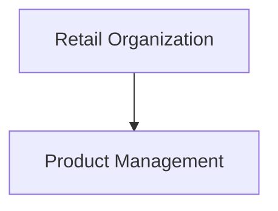

# Mermaid export

BiB YAML remains the canonical model. The Mermaid exporter converts BiB nodes and relationships into standard Mermaid flowchart syntax, so generated diagrams can be checked into Markdown or rendered by Mermaid-compatible tools.

## CLI

Export the sample model:

```bash
python3 -m bibcli.main --input examples/retail.yaml --output out/retail.mmd --format mmd
```

The output can be embedded in a Markdown file:

```markdown

```

Solid arrows represent the BiB `parent` hierarchy. Labeled dashed arrows represent `depends` relationships. If a dependency references a node missing from the YAML model, the exporter shows it as an external node. The node display name and type are included in its label.

Mermaid flowcharts are a portable rendering target, not a new Mermaid core diagram type. They do not preserve all BiB metadata such as tags, descriptions, weights, and arbitrary annotations.
